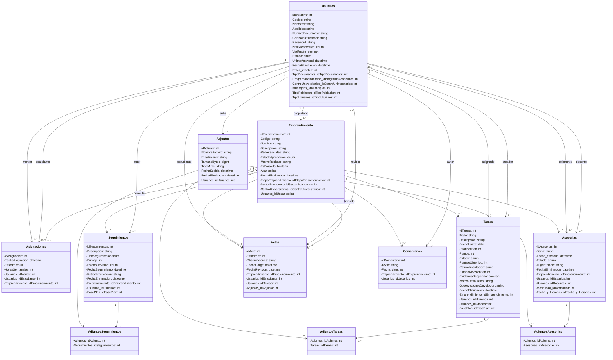
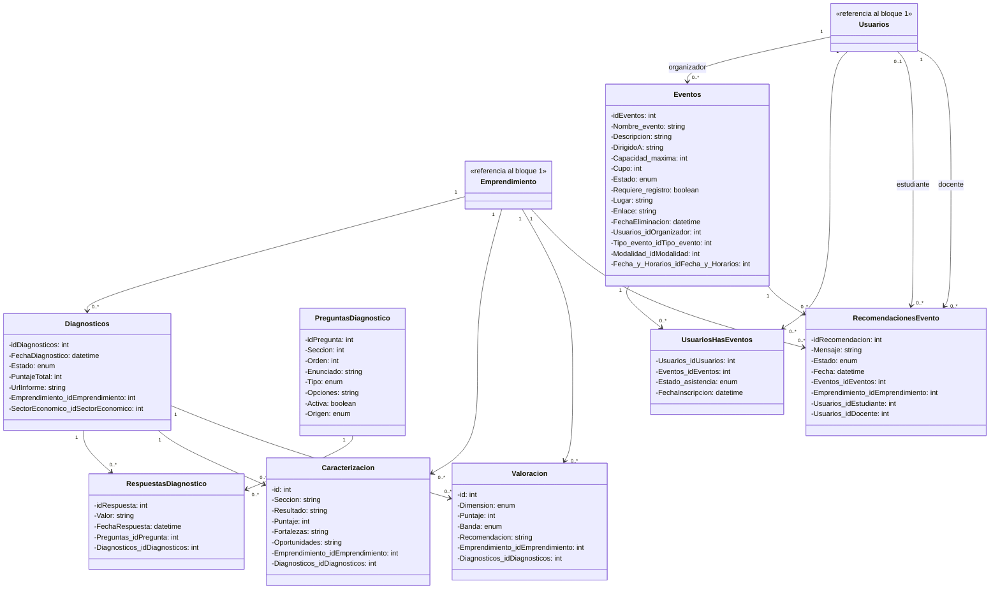

# Diagrama de Clases - SGEMD

Sistema de Gestión de Emprendimiento Minuto de Dios. Diagrama del **modelo de
datos** del MVP: las **27 entidades de negocio** con sus atributos y claves
foráneas, más los **14 catálogos** de solo lectura.

> **Versión 2.** Alineada con `MASTER_IMPLEMENTATION_PROMPT.md` v1.3 (§7.2, §13.2,
> §15, §20). Si este documento y el master discrepan, **manda el master** y este
> archivo se corrige. La lista de cambios respecto a la versión anterior está en
> la sección *Cambios de la versión 2*.
>
> **Complementa a `diagrama-componentes.md`**, no lo reemplaza. El diagrama de
> componentes muestra *dónde vive cada pieza* (frontend, Caddy, backend,
> PostgreSQL). Las clases muestran *cómo se estructura el negocio por dentro*.
> Junto con `context-diagram.mmd` completan la familia de diagramas del MVP.

## Procedencia y método

| Aspecto | Detalle |
| ------- | ------- |
| **Fuente** | `README.md` §5 *Modelo de datos*, contrastado con las 73 pantallas de `prototype/` y con el master v1.3 |
| **Contraste con** | `docs/fr_nfr_sgemd.md`, `docs/historias_usuario.md`, `docs/diagrama-componentes.md`, master §13.2 |
| **Herramienta** | Mermaid (`classDiagram`) |
| **Validación** | 27 clases + 14 catálogos, en **tres bloques** para que cada uno sea legible y renderizable. No se añadió ninguna tabla: el total de 41 se mantiene |

**Decisión de diseño (nombres).** Los atributos del diagrama son **nombres
lógicos en PascalCase**. Las columnas físicas son `snake_case` (por ejemplo
`CorreoInstitucional` → `correo_institucional`) y el mapeo entre ambos se hace de
forma explícita en los serializadores del backend, nunca por convención
implícita. Lo que se conserva de la decisión anterior es la razón de fondo: toda
divergencia entre diagrama y tabla termina siendo un bug de mapeo (el
`README.md` §10 registra como error histórico "joins que usaban columnas
inexistentes"). Por eso, en la Etapa 2 del master se verifica con un script que
`schema.sql` contiene cada atributo de este documento y que las listas CHECK
coinciden con `shared/src/enums.ts`. Las claves foráneas conservan el nombre
lógico que ven aquí; su nombre físico se fija una sola vez en `schema.sql`.

**Decisión de alcance.** Los **catálogos** no se dibujan como clases para no
saturar el diagrama; se listan en una tabla. Las claves foráneas a catálogo
aparecen como atributo `Catalogo_idCatalogo` en la entidad que las usa. Las
relaciones se leen por ficha y se garantizan con claves foráneas; **no se declara
un total de relaciones**.

**Borrado lógico (BR-006).** Las entidades que se pueden "eliminar" desde la
aplicación llevan `FechaEliminacion: datetime` (nulo = vigente). Una fila con
fecha queda oculta de listas y bloquea el acceso, pero conserva su historia. El
borrado confirmado de un emprendimiento o un usuario además elimina **físicamente**
sus archivos adjuntos; eso no es reversible y el diálogo lo advierte (master
§7.1, §20.5 #13 y #17).

**Tres bloques:**

| Bloque | Contenido | Clases |
|---|---|---|
| 1. Expediente | Usuario, emprendimiento, asignación, avance, tareas, asesorías, actas, comentarios y adjuntos | 12 |
| 2. Diagnóstico y eventos | Diagnóstico, preguntas/respuestas, valoración, eventos y recomendaciones | 8 |
| 3. Soporte del sistema | Verificación y recuperación, notificaciones, habilitaciones, solicitudes, configuración, respaldos y auditoría | 7 |

---

## Bloque 1 — Expediente del emprendimiento

---

## Bloque 2 — Diagnóstico y eventos

---

## Bloque 3 — Soporte del sistema

```mermaid
classDiagram
    direction TB

    class Usuarios {
        <<referencia al bloque 1>>
    }
    class Emprendimiento {
        <<referencia al bloque 1>>
    }

    class CodigosVerificacion {
        -idCodigo: int
        -CorreoInstitucional: string
        -Proposito: enum
        -Codigo: string
        -Expiracion: datetime
        -Usado: boolean
        -Intentos: int
        -Usuarios_idUsuarios: int
    }

    class Notificaciones {
        -idNotificaciones: int
        -Tipo: enum
        -Mensaje: string
        -Url: string
        -TipoObjeto: string
        -ObjetoId: int
        -Leida: boolean
        -Fecha: datetime
        -Usuarios_idUsuarios: int
    }

    class Habilitaciones {
        -idHabilitacion: int
        -Estado: enum
        -Fecha: datetime
        -Usuarios_idUsuarios: int
        -Modulos_idModulos: int
    }

    class Solicitudes {
        -idSolicitud: int
        -Tipo: enum
        -Detalle: string
        -Estado: enum
        -MotivoRechazo: string
        -FechaSolicitud: datetime
        -FechaResolucion: datetime
        -Usuarios_idUsuarios: int
        -Emprendimiento_idEmprendimiento: int
        -Usuarios_idResueltoPor: int
    }

    class ConfiguracionPrograma {
        -idConfiguracion: int
        -Clave: string
        -Valor: string
        -TipoDato: string
        -Descripcion: string
        -Usuarios_idUsuarios: int
    }

    class Respaldos {
        -idRespaldo: int
        -Codigo: string
        -Tipo: enum
        -FechaHora: datetime
        -TamanoLogicoMB: int
        -TamanoAnadidoMB: int
        -Estado: enum
        -Destino: string
        -RetencionDias: int
        -ChecksumManifiesto: string
        -Usuarios_idUsuarios: int
    }

    class AuditoriaEventos {
        -idAuditoria: int
        -Accion: enum
        -Entidad: string
        -EntidadId: int
        -ValorAnterior: json
        -ValorNuevo: json
        -Fecha: datetime
        -Ip: string
        -Usuarios_idUsuarios: int
    }

    Usuarios "1" --> "0..*" CodigosVerificacion
    Usuarios "1" --> "0..*" Notificaciones : destinatario
    Usuarios "1" --> "0..*" Habilitaciones
    Usuarios "1" --> "0..*" ConfiguracionPrograma : actualiza
    Usuarios "0..1" --> "0..*" Respaldos : genera
    Usuarios "0..1" --> "0..*" AuditoriaEventos : autor
    Usuarios "1" --> "0..*" Solicitudes : solicitante
    Usuarios "0..1" --> "0..*" Solicitudes : resuelve
    Emprendimiento "0..1" <-- "0..*" Solicitudes
```

---

## Catálogos (14, solo lectura)

Los valores son los **canónicos** del master §7.2 y §13.1; el seed debe usar
exactamente estas cadenas.

| Tabla | Valores | Usada por |
| --- | --- | --- |
| `roles` | 1 Admin · 2 Estudiante · 3 Docente · 4 Auditor *(Post-MVP)* | `Usuarios` |
| `tipodocumentos` | CC · TI · CE | `Usuarios` |
| `programaacademico` | Programa del estudiante | `Usuarios` |
| `centrouniversitarios` | Sede Norte · Sede Centro · Sede Sur | `Usuarios`, `Emprendimiento` |
| `municipios` | Departamento + ciudad | `Usuarios` |
| `tipopoblacion` | Población vulnerable | `Usuarios` |
| `tipousuarios` | Estudiante · Egresado · Docente · Administrativo | `Usuarios` |
| `etapaemprendimiento` | FASE 1 - Ideación · FASE 2 - Prototipo · FASE 3 - Validación · FASE 4 - Formalización | `Emprendimiento` |
| `faseplan` | FASE 1 Ideación y priorización de ideas · FASE 2 Estructuración y ejecución · FASE 3 Consolidación del proceso · FASE 4 Escalamiento | `Seguimientos`, `Tareas` |
| `sectoreconomico` | Alimentos · Moda · Ambiental · Muebles · Tecnología · Comercio | `Emprendimiento`, `Diagnosticos` |
| `modalidad` | Presencial · Virtual · Mixta | `Asesorias`, `Eventos` |
| `tipo_evento` | Startup · Capacitación · Asesoría grupal · Showroom · Taller | `Eventos` |
| `fecha_y_horarios` | Bloque de agenda (fecha, hora inicio, hora fin) | `Asesorias`, `Eventos` |
| `modulos` | Perfil · Emprendimiento · Diagnóstico · Tareas · Asesorías · Seguimiento · Eventos · Reportes | `Habilitaciones` |

> **Nota sobre fases:** `etapaemprendimiento` (avance global del emprendimiento) y
> `faseplan` (agrupación de tareas y avances) son **catálogos distintos**. No
> deben confundirse ni fusionarse (README §6, R17). Los alias del prototipo
> ("Ideación · Ejecución · Crecimiento · Consolidación") **no** son valores de
> `faseplan`.

---

## Enumeraciones

Cadenas exactas, con tildes; se implementan como restricciones CHECK y se
declaran una sola vez en `shared/src/enums.ts` (master §7.2).

| Campo | Valores |
| --- | --- |
| `Usuarios.Estado` | `Limitado` · `Activo` · `Inactivo` |
| `Usuarios.NivelAcademico` | `Pregrado` · `Posgrado` · `Egresado` (FR-024) |
| `Emprendimiento.EstadoAprobacion` | `Pendiente` · `Aprobado` · `Rechazado` |
| `Asignaciones.Estado` | `activa` · `inactiva` |
| `Seguimientos.TipoSeguimiento` | `Avance de fase` · `Comentario` |
| `Tareas.Estado` | `Pendiente` · `En curso` · `En revisión` · `Completada` · `Vencida` · `Devuelta` |
| `Tareas.Prioridad` | `Alta` · `Media` · `Baja` |
| `*.EstadoRevision` | `Pendiente` · `En revisión` · `Calificada` · `Devuelta` |
| `Asesorias.Estado` | `Por agendar` · `Programada` · `Confirmada` · `En curso` · `Completada` · `Cancelada` |
| `Actas.Estado` | `Pendiente` · `En revisión` · `Aprobada` · `Rechazada` |
| `Diagnosticos.Estado` | `En progreso` · `Enviado` · `Revisado` |
| `Valoracion.Banda` | `90-100` · `70-89` · `50-69` · `<50` |
| `Eventos.Estado` | `Pendiente` · `Aprobado` · `Rechazado` · `Publicado` |
| `Solicitudes.Tipo` | `Desbloqueo` · `Paralelo` · `Cita` |
| `Solicitudes.Estado` | `Pendiente` · `Aprobada` · `Rechazada` |
| `Respaldos.Tipo` | `Completo` · `Parcial` |
| `Respaldos.Estado` | `Exitosa` · `Fallida` |
| `Notificaciones.Tipo` | `Tarea` · `Asesoría` · `Seguimiento` · `Solicitud` · `Diagnóstico` · `Evento` · `Sistema` *(heredada de la versión anterior; no figura en el master §7.2, ver pendientes)* |
| `CodigosVerificacion.Proposito` | `Verificación` · `Recuperación` *(nuevo, ver pendientes)* |

`Asesorias`: la etiqueta de filtro `Agendada` del docente agrupa `Programada` +
`Confirmada` + `En curso`; **no** es un estado almacenado.
`Valoracion.Dimension` tiene 6 valores que dependen de la rúbrica (AQ-09) y no se
listan hasta que se apruebe. `AuditoriaEventos.Accion` debe cubrir como mínimo
altas, cambios, borrados, cambios de estado, lecturas y exportaciones del
auditor, descargas y exportaciones de respaldos, y las acciones de los jobs.

---

## Nulabilidad y restricciones que el diagrama no dibuja

**Claves que admiten nulo (a propósito):**

| Campo | Por qué |
| --- | --- |
| `Respaldos.Usuarios_idUsuarios` | El respaldo diario lo crea un job, sin usuario |
| `AuditoriaEventos.Usuarios_idUsuarios` | Los jobs (inactividad de 90 días, tareas vencidas) también escriben auditoría |
| `Asesorias.Usuarios_idDocentes` | Una solicitud del estudiante (`Por agendar`) todavía no tiene docente |
| `Actas.Usuarios_idRevisor`, `Actas.FechaRevision` | Hasta que el admin la revisa |
| `Actas.Adjuntos_idAdjunto` | Solo mientras el estudiante no ha subido el archivo |
| `Solicitudes.Emprendimiento_idEmprendimiento` | Un desbloqueo no está ligado a un emprendimiento |
| `Solicitudes.Usuarios_idResueltoPor`, `FechaResolucion` | Hasta que se resuelve |
| `RecomendacionesEvento.Usuarios_idEstudiante` | La recomendación puede ser a todo el emprendimiento |
| `*.FechaEliminacion` | Nulo = vigente |

**Restricciones que se implementan fuera del dibujo** (índices, CHECK y claves
compuestas en `schema.sql`; las multiplicidades por sí solas **no** las
garantizan):

- Un solo `Asignaciones.Estado = 'activa'` por emprendimiento: **índice único
  parcial** (R11). Las multiplicidades no lo expresan. Los topes de 12 h/semana y
  12 emprendimientos por docente se validan en el servicio, dentro de una
  transacción.
- Únicos: `Usuarios.CorreoInstitucional`, `Usuarios.NumeroDocumento`,
  `Emprendimiento.Codigo`, `Respaldos.Codigo`.
- Una respuesta por pregunta y diagnóstico: único (`Preguntas_idPregunta`,
  `Diagnosticos_idDiagnosticos`).
- Claves primarias compuestas: `UsuariosHasEventos` y las tres tablas
  `Adjuntos*`.
- `Tareas.Estado = 'Completada'` exige al menos un adjunto (BR-007);
  `EvidenciaRequerida` es siempre verdadero. Se valida en el servicio, no solo en
  la interfaz.
- Rechazo sin motivo prohibido: `Emprendimiento.MotivoRechazo`,
  `Solicitudes.MotivoRechazo` y `Actas.Observaciones` (motivo del rechazo del
  acta, BR-009) son obligatorios cuando el estado es rechazado. La
  `Tareas.MotivoDevolucion` es obligatoria al devolver (R19b).
- `Avance` (0–100) se deriva de las tareas; el cliente nunca lo envía.
- `PuntajeTotal` y `Valoracion` solo se escriben cuando la rúbrica está aprobada
  (AQ-09); mientras tanto la tabla permanece vacía.

---

## Trazabilidad: requisito → clase

Cada clase existe porque al menos un requisito la necesita (regla anti-lluvia:
*si un atributo no lo necesita ninguna historia, no entra*).

| Requisito / Regla | Clases del diagrama que lo soportan |
| ----------------- | ------------------------------------ |
| FR-001 Registro + OTP | `Usuarios`, `CodigosVerificacion` (`Proposito = Verificación`) |
| Recuperación de contraseña (T39) | `CodigosVerificacion` (`Proposito = Recuperación`) |
| FR-002 Diagnóstico automático | `Diagnosticos`, `PreguntasDiagnostico`, `RespuestasDiagnostico`, `Caracterizacion`, `Valoracion` |
| FR-003 / BR-001 / BR-009 Acta | `Actas`, `Adjuntos`, `Asignaciones` (la asignación exige un acta `Aprobada`) |
| FR-004 / FR-015 Asignación y agenda | `Asignaciones`, `Asesorias`, `Habilitaciones`, catálogo `fecha_y_horarios` |
| FR-005 / FR-019 Notificaciones | `Notificaciones`, `RecomendacionesEvento` |
| FR-006 / FR-017 Expediente | `Emprendimiento`, `Seguimientos`, `Tareas`, `Asesorias`, `Comentarios`, `AuditoriaEventos` |
| FR-007 / BR-005 Inactividad 90 días | `Usuarios.UltimaActividad`, `AuditoriaEventos` (autor nulo) |
| FR-008 Adjuntos | `Adjuntos`, `AdjuntosTareas`, `AdjuntosSeguimientos`, `AdjuntosAsesorias`, `Actas` |
| BR-006 Borrado lógico y cascada de archivos | `FechaEliminacion` en `Usuarios`, `Emprendimiento`, `Seguimientos`, `Tareas`, `Asesorias`, `Eventos`, `Adjuntos` |
| FR-009 / FR-018 / NFR-004 Exportar y respaldos | `Respaldos` |
| FR-010 Dashboards | Sin clase propia: son agregados SQL sobre las demás |
| FR-012 / BR-004 Aprobación y paralelo | `Emprendimiento`, `Solicitudes` |
| FR-011 / FR-013 Usuarios y estados | `Usuarios` |
| FR-014 Bandeja única | `Solicitudes` |
| FR-016 Topes docentes | `Asignaciones.HorasSemanales`, `ConfiguracionPrograma` |
| FR-020 Configuración | `ConfiguracionPrograma`, `AuditoriaEventos` (valor anterior y nuevo) |
| FR-021 Eventos y recomendación | `Eventos`, `UsuariosHasEventos`, `RecomendacionesEvento` |
| FR-022 Progreso por fase | `Seguimientos`, `Tareas`, catálogo `faseplan` (ambas llevan `FasePlan`) |
| FR-023 / BR-007 Evidencia obligatoria | `Tareas.EvidenciaRequerida`, `AdjuntosTareas` |
| FR-024 Datos académicos condicionales | `Usuarios.NivelAcademico` y los catálogos académicos |
| NFR-002 Autorización por alcance | `Asignaciones` (índice único parcial de la asignación activa) y las consultas del servicio; **no** las multiplicidades |
| NFR-007 Auditabilidad | `AuditoriaEventos` |

---

## Cambios de la versión 2

Estado: **Master** = lo exige el master v1.3; **Inferido** = lo exige un
requisito pero el master no lo lista, o lo propongo yo, y requiere confirmación.

| # | Cambio | Estado |
|---|---|---|
| 1 | La frase "nombres idénticos a las columnas físicas" pasa a "nombres lógicos con mapeo explícito a `snake_case`" | Master |
| 2 | `Respaldos`: `TamanoMB` se reemplaza por `TamanoLogicoMB` y `TamanoAnadidoMB`; se añade `ChecksumManifiesto`; autor nulo | Master (D13, D22) |
| 3 | `CodigosVerificacion`: se añade `Intentos`; `Codigo` guarda un HMAC | Master (§15, D20) |
| 4 | `CodigosVerificacion.Proposito` para el token de recuperación de contraseña | Inferido (el master tiene T39 pero ninguna tabla de tokens) |
| 5 | Catálogos con los valores canónicos; `fecha_y_horarios` en minúsculas | Master |
| 6 | `Usuarios`: `NivelAcademico` y claves a los seis catálogos académicos | Master (§13.2 "academic fields", FR-024) |
| 7 | `FechaEliminacion` en siete entidades | Inferido (BR-006 exige borrado lógico; el master no nombra la columna) |
| 8 | `Emprendimiento`: `Descripcion`, `RedesSociales`, claves a sector y sede | Master |
| 9 | `Tareas`: `Descripcion`, `Retroalimentacion`, `MotivoDevolucion`, `ObservacionesDevolucion` | Master |
| 10 | `Tareas.FasePlan_idFasePlan` y `Usuarios_idCreador` | Inferido (FR-022 necesita la fase de cada tarea; el docente crea la tarea) |
| 11 | `Actas`: se elimina `UrlArchivo` y se enlaza `Adjuntos`; se añaden `FechaCarga`, `FechaRevision` y `Usuarios_idEstudiante` | Master para las fechas; el resto inferido (un solo camino de archivos para MIME, borrado y respaldo) |
| 12 | `Adjuntos`: `FechaSubida`; `TamanoBytes` pasa a 64 bits | Master (fecha); 64 bits inferido (el límite es configurable) |
| 13 | `Eventos`: `Descripcion`, `Lugar`, `Enlace`, `Usuarios_idOrganizador` | Master |
| 14 | `Asesorias`: clave a `fecha_y_horarios` (el catálogo ya decía que la usaba) | Master |
| 15 | `Asignaciones` → `Emprendimiento` pasa de `0..1` a `1`; la unicidad de la asignación activa se documenta como índice parcial | Master (R11) |
| 16 | `Diagnosticos` → `RespuestasDiagnostico` pasa de `1..*` a `0..*` (guardar y retomar) | Master (T25) |
| 17 | `Seguimientos`: `FechaSeguimiento` y `Retroalimentacion` | Inferido (la vista del estudiante muestra fecha y retroalimentación) |
| 18 | `Notificaciones.Fecha` | Inferido (ordenar el cajón de notificaciones) |
| 19 | Se corrige la trazabilidad: FR-010 son dashboards derivados (no `Solicitudes`) y NFR-002 no lo dan las multiplicidades | Corrección del documento |
| 20 | Se amplía la tabla de enumeraciones y se añade la sección de nulabilidad y restricciones | Master (§7.2) |
| 21 | Se eliminan las referencias a PNG y `.drawio` borrados | Corrección del documento |

## Pendientes de confirmar

- **Cambios 4, 7, 10, 11 (parte), 17 y 18** son inferidos. Confirmar contra
  `README.md` §5 antes de pasarlos al master §13.2.
- **Dónde se guarda la fecha reprogramada** cuando el docente propone otra
  fecha en una asesoría: el master no lo especifica.
- **Revisor y recomendaciones del docente en el diagnóstico**
  (`Diagnosticos.Estado = Revisado`): no hay columna para quién lo revisó ni para
  su recomendación.
- **`Diagnosticos.UrlInforme`**: si el informe se genera al vuelo, la columna
  sobra; si se guarda, debería enlazar `Adjuntos`.
- **`Notificaciones.Tipo`**: la lista no aparece en el master §7.2; verificar su
  origen en `README.md`.
- **`Valoracion.Dimension`** y los valores de `AuditoriaEventos.Accion`
  dependen de AQ-09 y de la implementación de la auditoría.

---

## Cómo llevarlo a draw.io (visual)

Copia cada bloque Mermaid a mermaid.live o a
*draw.io → Arrange → Insert → Advanced → Mermaid* y exporta la imagen.

> Los bloques Mermaid de este `.md` **son la fuente de verdad**: son texto, se
> versionan en Git, se revisan con `diff` y los puede regenerar cualquier
> herramienta. Los PNG y el `.drawio` de la versión anterior se borraron del
> repositorio porque describían un modelo obsoleto; si hacen falta, se regeneran
> desde estos bloques.

## Archivos

| Archivo | Formato | Uso |
| ------- | ------- | --- |
| `diagrama-clases.md` | Markdown | Diagramas Mermaid, catálogos, enumeraciones, restricciones y trazabilidad (este documento) |
