# Diagrama de Componentes — SGEMD

Sistema de Gestión de Emprendimiento Minuto de Dios. Diagrama de componentes
del MVP: frontend React, backend Node/Express, seguridad (JWT + bcrypt + OTP),
persistencia **PostgreSQL 17**, bandeja de notificaciones, almacenamiento de
archivos (≤ 500 MB), servicio SMTP, respaldos programados e infraestructura
Docker.

> **Regenerado el 2026-10-25** contra el prototipo (73 pantallas) y `README.md`
> §4/§5/§7. La versión anterior no incluía los servicios de **solicitudes,
> configuración, respaldos, auditoría ni habilitaciones**, no tenía procesos
> programados y no contemplaba el rol **auditor**.

## Diagrama (Mermaid)

```mermaid
flowchart TB
    subgraph FRONT["Frontend — React (SPA)"]
        direction LR
        F_AUTH["Auth · Login / Registro / OTP / Recuperación"]
        F_ADMIN["Panel Admin (19)<br/>usuarios · emprendimientos · solicitudes · configuración · respaldos"]
        F_DOC["Panel Docente (23)<br/>avances · tareas · asesorías · eventos · comentarios"]
        F_EST["Panel Estudiante (27)<br/>progreso · tareas · diagnóstico · plan · eventos"]
        F_AUD["Panel Auditor (Post-MVP)<br/>consulta y exportación"]
        F_API["Cliente API central<br/>Bearer token · redirige en 401/403"]
    end

    subgraph BACK["Backend — Node.js + Express (API REST /api)"]
        direction TB
        subgraph MW["Middleware"]
            M_AUTH["authenticateToken (JWT)"]
            M_ROL["isAdmin · isTeacher · isStudent · isAuditor"]
            M_VAL["Validación de entrada<br/>+ consultas SQL parametrizadas"]
        end
        subgraph SVC["Servicios por módulo<br/>routes → controllers → services → BD"]
            S_AUTH["AuthService<br/>register · verify · login · logout"]
            S_USER["UserService<br/>CRUD · avatar · estados · habilitaciones"]
            S_EMP["EmprendimientoService<br/>CRUD · aprobación · paralelos · avance"]
            S_ASIG["AsignaciónService<br/>mentor ↔ estudiante · topes 12 h / 12 emp."]
            S_SEG["SeguimientoService<br/>avances · puntaje · estado de revisión"]
            S_TAREA["TareaService<br/>CRUD · prioridad · calificar · devolver"]
            S_ASES["AsesoríaService<br/>solicitud · asignación · reprogramación"]
            S_SOL["SolicitudService<br/>bandeja única · desbloqueos · paralelos · citas"]
            S_EVENT["EventoService<br/>eventos · asistencia · recomendaciones"]
            S_DIAG["DiagnósticoService<br/>preguntas · respuestas · informe"]
            S_CFG["ConfiguracionService<br/>parámetros del programa"]
            S_BKP["RespaldoService<br/>crear · historial · integridad"]
            S_AUD["AuditoriaService<br/>log de operaciones sensibles"]
            S_NOTIF["NotificacionService<br/>bandeja · contador · marcar leídas"]
            S_DASH["DashboardService<br/>métricas reales de BD"]
        end
        subgraph JOB["Procesos programados (cron)"]
            J_BKP["Respaldo diario 09:00<br/>retención 30 días"]
            J_INA["Inactividad 90 días<br/>→ Estado Inactivo"]
            J_VENC["Tareas vencidas<br/>→ Estado Vencida"]
        end
        subgraph FILES["Almacenamiento de archivos"]
            FIL["Uploads locales<br/>adjuntos ≤ 500 MB"]
            CASC["Borrado en cascada<br/>BR-006"]
        end
    end

    subgraph SEG["Seguridad"]
        JWT["JWT · expiración 8 h"]
        BCRYPT["bcrypt · hash de contraseñas"]
        OTP["Código OTP 8 dígitos<br/>validez 5 min"]
    end

    subgraph DB["Persistencia — PostgreSQL 17 (41 tablas)"]
        direction LR
        T_USU["usuarios<br/>(Limitado · Activo · Inactivo)"]
        T_EMP["emprendimiento<br/>(Pendiente · Aprobado · Rechazado)"]
        T_EXP["expediente<br/>seguimientos · tareas · asesorías"]
        T_DIAG["diagnóstico<br/>preguntas · respuestas · valoración"]
        T_SOL["solicitudes<br/>+ configuración · respaldos"]
        T_NOTIF["notificaciones<br/>+ comentarios · recomendaciones"]
        T_AUD["auditoria_eventos"]
        T_ADJ["adjuntos + 3 pivotes"]
        T_CAT["14 catálogos"]
    end

    SMTP["Externo — SMTP<br/>OTP + correo de bienvenida"]
    STORE["Externo — Almacenamiento institucional<br/>destino de respaldos"]

    subgraph INFRA["Infraestructura"]
        DOCKER["docker-compose<br/>backend | frontend | postgres"]
        ENV[".env<br/>secretos y credenciales"]
    end

    F_AUTH --> F_API
    F_ADMIN --> F_API
    F_DOC --> F_API
    F_EST --> F_API
    F_AUD --> F_API

    F_API -->|"HTTP/JSON · Authorization: Bearer"| M_AUTH
    M_AUTH --> M_ROL
    M_ROL --> M_VAL
    M_VAL --> SVC

    S_AUTH --> JWT
    S_AUTH --> BCRYPT
    S_AUTH --> OTP
    S_AUTH --> SMTP
    OTP --> T_USU

    SVC --> DB
    SVC --> FIL
    FIL --> CASC
    CASC --> T_ADJ

    S_NOTIF -.->|"bandeja (sin realtime)"| F_API
    S_AUD --> T_AUD
    S_CFG --> T_SOL
    S_SOL --> T_SOL

    J_BKP --> S_BKP
    J_INA --> S_USER
    J_VENC --> S_TAREA
    S_BKP --> STORE

    DB --> DOCKER
    ENV -.-> DOCKER
```

Fuente: `README.md` §4 (arquitectura), §5 (modelo de datos) y §7 (API), contrastado con las 73 pantallas de `prototype/`.

## Cambios respecto de la versión anterior

| Elemento | Antes | Ahora |
| --- | --- | --- |
| Servicios | 10 (auth, users, emp, asig, seg, tarea, asesoría, evento, diagnóstico, dashboard) | **+5**: `SolicitudService`, `ConfiguracionService`, `RespaldoService`, `AuditoriaService`, `NotificacionService` |
| Roles | 3 (`isAdmin`, `isTeacher`, `isStudent`) | **+ `isAuditor`** (Post-MVP, solo lectura) |
| Procesos programados | Ninguno | **3**: respaldo diario, inactividad a 90 días, tareas vencidas |
| Archivos | Uploads citados sin ciclo de vida | **Borrado en cascada** explícito (BR-006) |
| Notificaciones | `Socket.io` en tiempo real | **Bandeja** sin emisión realtime: el prototipo no la implementa y el requisito queda como deuda de backend |
| SMTP | Solo OTP | **OTP + correo de bienvenida** |
| Persistencia | 9 tablas representativas | **41 tablas** agrupadas por dominio + **14 catálogos** |
| Auditoría | Ausente | `auditoria_eventos` conectada a `AuditoriaService` |
| Respaldos | Ausentes | `RespaldoService` + destino externo |

## Cómo llevarlo a draw.io (visual)

1. **Opción A — Mermaid → draw.io online:** copia el bloque Mermaid de arriba a
   mermaid.live, exporta la imagen y arrástrala a draw.io.
2. **Opción B — draw.io con Mermaid:** *Arrange → Insert → Advanced → Mermaid* y
   pega el bloque.
3. **Opción C — Importar PNG:** usa `diagrama-componentes.png`, regenerado desde
   este Mermaid.

## Archivos generados

| Archivo                       | Formato    | Uso                                       |
| ----------------------------- | ---------- | ----------------------------------------- |
| `diagrama-componentes.md`     | Markdown   | Diagrama en Mermaid (este documento)      |
| `diagrama-componentes.png`    | Imagen     | **Regenerado** desde el Mermaid           |
| `diagrama-componentes.drawio` | XML/mxGraph| **Obsoleto**. Regenerar desde el Mermaid  |
